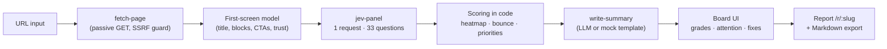

# FirstScreen — a third opinion on your landing page

Paste a URL and a panel of personas (**Investor**, **First-time User**, **Designer**) judges only the **first screen** — what's visible above the fold at 1440×900 (desktop) or 390×844 (mobile) — on three rubrics: **Clarity**, **Trust**, and **Call to Action**.

**Jev scores, code aggregates, the LLM writes.**

- **Jev** (TypeSafe AI's fast decision model, `jev-1.13.0`) answers every persona × rubric score, gap, and continue question in a **single multi-question request** (33 questions total).
- **Code** does all the math: scaling, confidence weighting, bounce risk, fix priorities, and the two heatmaps.
- **The LLM** (writer) only writes the final summary and rewrite suggestions, and sees only the parsed first screen plus Jev's aggregated numbers — never raw page HTML.

## How it works



## Rules & scope

- **Passive fetch only.** `GET` the page HTML plus up to 5 linked same-origin stylesheets. No form submits, logins, or crawling beyond the one URL. http/https only.
- **SSRF guard.** localhost, private/link-local/CGNAT/unique-local/IPv4-mapped/reserved ranges, `169.254.169.254`, `.internal`/`.local`, and non-standard ports are blocked. Redirects are followed manually (max 3) and re-checked at every hop, including an A + AAAA DNS lookup that must resolve only to public addresses (DNS failures are refused).
- **Caps.** 10 requests, 2 MB per file (streamed, aborted once exceeded), 15 s per analysis. One analysis per URL per minute (enforced per workspace). Every paid upstream call (Jev, the writer LLM, the optional screenshot service) reserves one unit of a daily cap (default 200 per function) right before it is made; the cap fails closed.
- **Untrusted page content.** Page text is wrapped as data in every Jev and LLM call. Instruction-like text ("ignore previous instructions", "rate this 10/10") is flagged in the UI and never obeyed.
- **Secrets stay server-side.** All API keys live in Supabase Edge Function secrets. Nothing secret is in the browser bundle.
- **No JS execution.** The page is parsed statically, so the fold position is approximate and SPA shells are detected and reported ("content rendered only by JS, so the analysis is limited").

## Why Jev?

Jev is cheap and calibrated for per-question judgment. Instead of fanning out 33 LLM calls (or one bloated prompt that conflates personas), FirstScreen sends **one Jev request carrying all 33 namespaced questions** — each with its own persona, criteria, and answer type (`score`, `choice`, `noul`). That gives calibrated probabilities per question for pennies, and all aggregation stays in deterministic code. The writer LLM is only invoked once, at the end, to turn numbers into prose.

## Setup

```bash
# 1. Set the secrets (server-side only)
supabase secrets set TYPESAFE_API_KEY=... OPENAI_API_KEY=... OPENAI_MODEL=gpt-6-luna
# optional:
supabase secrets set OPENAI_BASE_URL=https://api.openai.com/v1 SCREENSHOT_API_URL=https://your-screenshot-service/?url={url}&w={w}&h={h}

# 2. Deploy the edge functions
supabase functions deploy

# 3. Run
npm install
npm run dev
```

Demo fixtures with recorded Jev responses are bundled — the **Load demo** buttons and **Offline replay** toggle work with no network or keys.

## Environment variables

| Variable | Where | Required | Purpose |
|---|---|---|---|
| `VITE_SUPABASE_URL` | browser | yes | Supabase project URL (functions, DB, storage) |
| `VITE_SUPABASE_ANON_KEY` | browser | yes | Supabase anon key |
| `TYPESAFE_API_KEY` | Edge Function secret | for live Jev | Jev API key |
| `OPENAI_API_KEY` | Edge Function secret | for live writer | Writer LLM key |
| `OPENAI_MODEL` | Edge Function secret | no | Writer model (default `gpt-6-luna`) |
| `OPENAI_BASE_URL` | Edge Function secret | no | Writer API base (default `https://api.openai.com/v1`) |
| `SCREENSHOT_API_URL` | Edge Function secret | no | Template URL with `{url}`, `{w}`, `{h}`; enables real screenshots |
| `DAILY_CALL_LIMIT` | Edge Function secret | no | Per-function daily cap on upstream calls (default `200`) |

`.env.example` lists only the two `VITE_` vars.

## Scoring model (all in code)

- **Cell score** (persona × rubric): Jev score (0–4) → `display = 100·s/4`, with a "low confidence" badge when confidence < 0.5.
- **Rubric score** = mean across personas; **persona score** = mean across rubrics; **overall** = mean of the 9 cells. Grades: A ≥ 85, B ≥ 70, C ≥ 55, D ≥ 40, else F.
- **Bounce risk** per persona = `1 − noul(would_continue)` averaged over rubrics.
- **Fix priority** per gap = `(100 − cell) × gap_choice_confidence`, deduped by gap across personas (priorities summed).
- **Attention heatmap** weight per block = mean across personas of `P(look first) × 0.6 + P(click first) × 0.4`. A "CTA not noticed" flag appears when the top CTA's weight is below the median block weight.
- **Fallback (not Jev):** if Jev is unreachable, a clearly-labeled heuristic scores the block list (h1 present, CTA count, trust blocks).

## Screenshots

| Desktop board | Attention view |
|---|---|
|  |  |

## Limitations

- **No JS execution** — pages that render everything client-side yield an empty first screen; the tool says so explicitly.
- **Approximate fold** — block positions are estimated from document order and prominence hints, not real layout.
- **Simulated personas** — the Investor/User/Designer are Jev's calibrated opinions, not real user research.

## Design decisions

- **One Jev request, not 33.** Namespaced question IDs (`user__clarity__score`, …) in a single multi-question call are much faster and cheaper than fanning out; a per-persona split (3 requests) is the fallback if the combined request fails validation.
- **Aggregation in code.** The model never does math; code computes means, priorities, and heatmap weights, so the numbers are reproducible and unit-testable.
- **The writer sees numbers, not HTML.** This keeps prompt-injection surface minimal and makes the summary faithful to the scores.
- **Mock writer still runs Jev live.** The "Mock writer" toggle only replaces the prose; "Offline replay" is the fully offline mode using recorded responses.
- **Heat colors go cool → warm** (weak → strong) on both the persona × rubric grid and the element-attention overlay.
